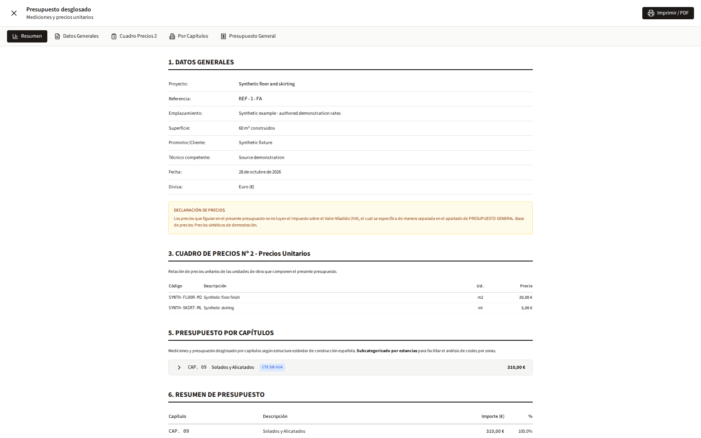

# Leo Estimate — renovation estimates for Spanish properties

Estimate a property’s renovation before making an offer. Built for property buyers and estate agents in Spain, with room-by-room work, quantities and price evidence.

The original app keeps the listing, rooms, proposed work and itemized estimate together. The source includes its Next.js interface, FastAPI services, worker pipeline and deterministic costing modules.



The sample estimate uses independently authored rates and measurements: two work items totaling €310. Provider accounts, licensed reference data and the full analysis pipeline have their own [setup guide](docs/setup.md).

## First result

Use Python 3.12:

```sh
python3.12 -m venv .venv
.venv/bin/python -m pip install -r requirements-first-result.txt
.venv/bin/python tools/first-estimate.py
.venv/bin/python -m unittest discover -s tests -v
```

The command writes a private local receipt and SQLite records: **two items, €310 total, 7.4 synthetic labor hours**. It executes the original price lookup, coverage validator, measurement catalogue, formula evaluator and BOQ assembler. The receipt identifies the inputs, calculations, source hashes and local persistence seam. [Calculation guide](tools/README-first-estimate.md).

These authored demonstration rates are synthetic; the receipt describes a calculation, rather than a market quotation or an analyzed property.

## App

Use Node 22.12 or later:

```sh
cd frontend
npm ci
npm run dev
```

Open `http://127.0.0.1:3002/first-estimate` for the original report interface backed by the proved synthetic rows. `/listings` opens the original listing workspace. This is the original workspace. Its listing importer uses the backend, recipient-owned provider accounts and licensed inputs. [Setup](docs/setup.md) records the database and full-pipeline integration boundary.

## Guide

- [Setup](docs/setup.md): runtimes, private configuration and database artifacts.
- [Workflows](docs/workflows.md): listing → rooms → comparable standard → work → quantities → estimate.
- [Architecture](docs/architecture.md): queue, worker, providers, calculation and persistence.
- [Decisions](docs/decisions.md): why the interface and extraction behave this way.
- [Providers and data](docs/providers.md): account ownership, model settings and reference-data rights.
- [Source reference](docs/reference/README.md): modules, symbols and source lines.
- [Release status](RELEASE-STATUS.md): verified results and remaining acceptance work.

Source authority: `latintzar/leo-archive`, `full-snapshot-2026-03-20`, commit `4dca5f9bd94a3ee4759dff949f3d185acd095022`. [Provenance](docs/provenance.md). Original code is MIT; fonts and dependencies retain their licences.

[made by atelier neyra](https://atelierneyra.com)
