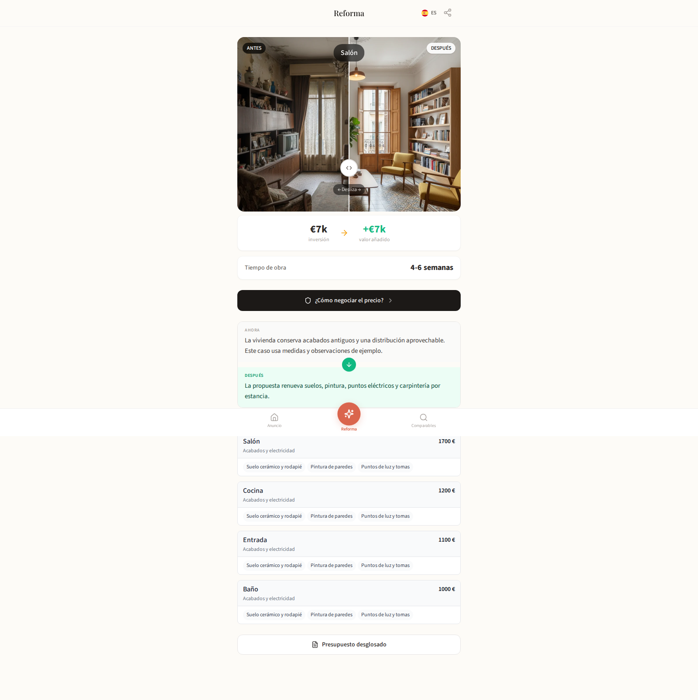

# Leo Estimate

Leo Estimate is a renovation cost estimator for Spanish properties, with room-by-room work, quantities and price evidence.

[Website](https://atelierneyra.com/renovation-estimates) · [Documentation](https://docs.atelierneyra.com/leo-estimates/overview/)

The original app keeps the listing, rooms, proposed work and itemized estimate together. The source includes its Next.js interface, FastAPI services, worker pipeline and deterministic costing modules.



The workspace opens with three fictional properties and complete cached reports: four rooms and 24calculated work items per property. The photographs are recovered, originally generated project assets. Prices, measurements, observations and comparable properties are authored examples.

## Run the app

Use Node 22.18+ in the Node 22 line and Python 3.10+, from the repository root:

```sh
git clone https://github.com/latintzar/renovation-estimates.git
cd renovation-estimates
npm ci --prefix frontend
python3 tools/sample-app.py build
python3 tools/sample-app.py start
```

Open **http://127.0.0.1:3002**. Browse the original listing feed, open a property, compare the before/after, explore rooms and comparables, then open **Presupuesto desglosado** for measurements, itemized costs and printing. This runs the complete native Next interface with a real read-only local API. [Native workspace](docs/native-workspace.md) explains the cached reports and deployment. [Provider setup](docs/setup.md) activates the original FastAPI, worker and analysis pipeline with recipient-owned services.

## Run the costing modules

From the repository root, use Python 3.12:

```sh
python3.12 -m venv .venv
.venv/bin/python -m pip install -r requirements-first-result.txt
.venv/bin/python tools/first-estimate.py
.venv/bin/python -m unittest discover -s tests -v
```

The command writes a private local receipt and SQLite records: **two items, €310 total, 7.4 synthetic labor hours**. It executes the original price lookup, coverage validator, measurement catalogue, formula evaluator and BOQ assembler. The receipt identifies the inputs, calculations, source hashes and local persistence seam. [Calculation guide](tools/README-first-estimate.md).

These authored demonstration rates are synthetic; the receipt describes a calculation, rather than a market quotation or an analyzed property.

## Guide

- [Native workspace](docs/native-workspace.md): cached reports, API contracts and deployment.
- [Setup](docs/setup.md): runtimes, private configuration and database artifacts.
- [Workflows](docs/workflows.md): listing → rooms → comparable standard → work → quantities → estimate.
- [Architecture](docs/architecture.md): queue, worker, providers, calculation and persistence.
- [Decisions](docs/decisions.md): why the interface and extraction behave this way.
- [Providers and data](docs/providers.md): account ownership, model settings and reference-data rights.
- [Source reference](docs/reference/README.md): modules, symbols and source lines.
- [Release status](RELEASE-STATUS.md): verified results and remaining acceptance work.

Source authority: `latintzar/leo-archive`, `full-snapshot-2026-03-20`, commit `4dca5f9bd94a3ee4759dff949f3d185acd095022`. [Provenance](docs/provenance.md). Original code is MIT; fonts and dependencies retain their licences.

[made by atelier neyra](https://atelierneyra.com)
