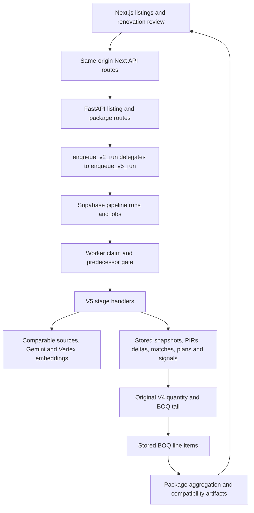

# Architecture

The first runnable calculation is [the synthetic estimate](../tools/README-first-estimate.md). It uses the original price lookup, measurement catalogue, quantity evaluator, plan validator and BOQ assembler. The full listing/photo/model workflow has a separate service and data boundary.

## Application and services

At the pinned implementation, the local application opens `/listings`. The middleware redirects local root requests there. `/estimate` renders the Spanish marketing page; the property workspace is `/listing/{id}`.

The Next.js frontend proxies same-origin `/api` requests to a recipient-selected FastAPI backend. The backend stores listings, pipeline jobs, events and estimate artifacts through Supabase REST/RPC. A separate Python worker executes jobs. SQLite in the starter belongs to its synthetic price book and proof sink; it is not the original service database.

Sources: [Next listing submission](../frontend/src/app/listings/page.tsx), [pipeline proxy](../frontend/src/app/api/listings/[id]/run-pipeline/route.ts), [backend routes](../backend/routes/v2_routes.py), [scheduler](../backend/pricing/v2_scheduler.py), [worker](../backend/workers/pipeline_worker.py), [database boundary](../backend/database.py).

## V5 stages and the V4 tail

The V2 route name is retained for clients. `enqueue_v2_run` delegates to `enqueue_v5_run`; the latter permits the `market_standard` strategy. [The stage registry](../backend/pipeline/v5_stages.py) supplies ordering, artifact keys and stage versions.

The path is listing snapshot → comparables/snapshot → target photo clusters → room tags/PIR → selected comparable and its room PIRs → slot deltas/review → work items → measurements → price-code matching → quantity plan → signal extraction → BOQ assembly/finalization → summaries, images and translations. Some stages are deterministic; photo interpretation, planning and generated narrative/image stages call providers.

[The V5 orchestrator](../backend/pricing/v5_run_market_standard.py) reuses `run_v4_tail_from_v5_work_items`. The worker also exposes individual V5 tail handlers in [handlers.py](../backend/workers/handlers.py). These are implementation entry points; earlier V2 implementation plans and V4 design documents explain their history rather than selecting the executable path.

## Price and quantity boundary

`_plans_validate_or_raise` requires a plan for every matched work item. For this pipeline it narrows each plan to one self-describing `SIGNAL` with a compatible unit. The underlying [formula evaluator](../backend/pricing/quantity_formula_v4.py) supports arithmetic AST nodes, checks units and rejects missing, nonfinite or negative results. The [measurement catalogue](../backend/pricing/measurement_catalog_v4.py) defines the existing measurement vocabulary.

`assemble_v4_boq` joins each plan to its room and price match, evaluates signals, applies the original quantity sanity caps and multiplies quantity by the supplied unit price. It retains formula, signals used, work item, room, dimension and match-mode provenance. `db.save_boq_line_items_batch` is its persistence seam.

Coverage is checked upstream and in the fixture receipt. The assembler iterates the plans supplied to it; nonempty BOQ aggregation alone does not prove every dimension was complete.

## Persistence and recovery

The scheduler creates jobs with idempotency keys. The worker claims jobs through a Supabase RPC and gates a V5 stage on its direct predecessor. Queued/running predecessors defer later work; failed/cancelled predecessors prevent successful continuation.

`_heartbeat_loop` renews a lease every 15 seconds by default and requests a 60-second extension. Renewal failure logs and retries. Processing acknowledges completion only after checking cancellation; errors enter the existing retry/fail path. The worker also reaps stale jobs and flushes job events/logs. This is lease-based recovery code, rather than proof of exactly-once provider effects. Fresh schema/RPC bring-up and worker restart recovery remain outside the first-estimate proof.

## Data and provider ownership

The full path requires recipient-owned Supabase state, listing/photo rights, provider accounts and price/reference data. The release excludes original construction/BCCA databases, reference indexes, embeddings and operational/customer records absent a grant.

The default matcher expects a full f32 embedding/metadata pair, with a fallback pair. All four expected files, plus the full labor index text, are absent from the pinned archive’s tree metadata. Restricted database/dimension artifacts cannot be restored by assumption.

With owned inputs, [the full index builder](../backend/pricing/scripts/build_bcca_embedding_index_full.py) writes the expected full pair; [the dimension builder](../backend/pricing/scripts/build_bcca_dimension_artifacts_v1.py) derives dimension artifacts from metadata. Those steps involve the recipient’s embedding service. The first estimate uses its own authored SQLite rows and skips matching/model inference entirely.
