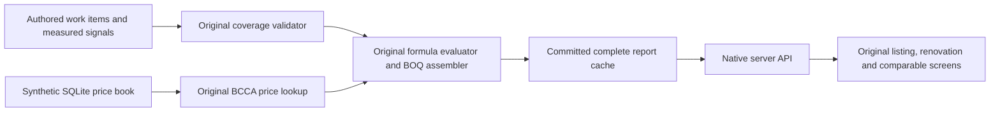

# Native workspace

The original Next listing, renovation and comparable screens run with complete cached sample reports. The same source and launcher produce the hosted preview and a recipient's local app.

## First result

Follow [Setup](setup.md), then open the default `/listings` feed. Select a property for the original `/listing/101`–`103` workspace. **Reforma** contains the before/after slider, investment, room plan and **Presupuesto desglosado**. **Anuncio** shows property information and the image gallery. **Comparables** shows three authored comparison properties. The detailed budget uses the retained report component, including chapter expansion and printing.

Three fictional properties each have four rooms and 24calculated work items. Records, measured signals, reference values and narrative observations are authored. Six recovered generated images are matched to the original `generate_room_photos.py`/`generate_landing_images.py` sources and hashes. [Media provenance](assets/generated-property-images.json). Agency photos, private property exports and commercial comparable responses remain outside this package.

## Calculation

`tools/build-native-sample.py` validates original calculation blobs at `leo-archive` commit `4dca5f9bd94a3ee4759dff949f3d185acd095022`. It calls the real `_plans_validate_or_raise`, `assemble_v4_boq`, quantity evaluator, measurement catalogue and `BCCAPriceLookup`; its only persistence adapter is a private local SQLite sink.72 rows are calculated across three properties. Every line carries synthetic price codes, formula AST and measured signal provenance. The authored narrative and comparison data are separate from this mathematical proof. Model worklist/planning, image interpretation, acquisition and live price data are recipient-owned stages.

## Server contract

`frontend/src/proxy.ts` selects this mode only with `SAMPLE_MODE=1`. `src/lib/sample/response.mjs` serves an allowlist of read-only native API contracts: listings/photos, cached packages/status, comparable brackets/list and stored measurement records. Unknown paths and all writes return 503 with `RECIPIENT_SERVICE_REQUIRED`; missing catalogue IDs return 404. Listing pagination is bounded to 50. Responses carry no-store and nosniff. The API reads the committed authored cache; the browser makes real same-origin requests. Original route handlers/FastAPI/worker adapters remain available in recipient mode.

`src/lib/app-path.ts` prefixes retained relative request paths; it supplies no response data. Next links/router handle the configured base path. Root navigation normalizes the mounted prefix and opens `/listings`. Images/fonts/flags are local. Share links use the recipient's origin and mount path. The original detailed-budget component already had its overlay/state but lacked an activating control; the derivative connects that existing callback from the native report. Budget address and area come from the selected listing/summary; professional assignment remains explicit. Overwrite client-supplied forwarding headers at ingress.

## Runtime

The sample launcher clears inherited provider keys and home cloud profiles, disables metadata discovery, and rejects private dotenv files. Its build creates `frontend/.next/standalone`, copies public/static assets and records mode/base path. Start that artifact with the same prefix on loopback, behind a proxy that preserves the prefix. This read-only workspace stores no visitor property/account records on the server. Native browser language preferences remain in that browser. Recipient-mode storage keeps its separate database/account contracts.

## Decisions · 2026-10-28

These are retrospective extraction choices:

- Preserve the whole original native application and API shapes. The first useful view is the populated property feed, followed by a complete report.
- Compute quantities and costs with original algorithms. Authored measurements/rates make the proof reproducible while keeping data grants separate from code permission.
- Cache the completed report for first use. This lets recipients explore the original UX before commissioning analysis/worker services.
- Keep sample APIs read-only and explicitly selected. Real pipeline actions retain their original provider adapters and require recipient configuration.
- Package Next standalone output. The runtime remains compact and matches the public source without shipping a development dependency tree.
- Recover the project's generated images and local icon/font notices. The native visuals remain source-faithful and self-hosted.

## Verification and commissioning

Fresh frontend npm installation, full Next 16.4.3 build and TypeScript checks pass. Pure server-contract tests cover complete cached reports, exact BOQ totals, bounded pagination, readonly behavior and provider-path denial. Actual Chromium checks desktop/phone listing, renovation, property and comparable views, the detailed budget, selected-property address/area, professional assignment state and print layout. Source/publication receipts record final hashes.

Live acquired listings, model/photo analysis, queue/Supabase bootstrap, embedding reference artifacts, measured maps, negotiation, translation providers, communications and billing are recipient commissioning. All source preparation and cached workspace proof use zero model/provider calls.
