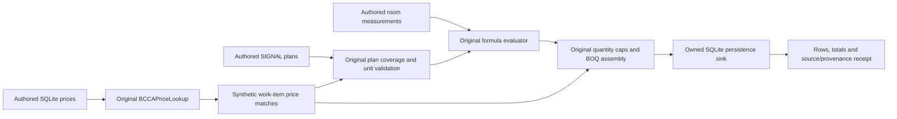

# Workflows

## First synthetic estimate

```sh
PYTHONDONTWRITEBYTECODE=1 python3 tools/first-estimate.py
```

The command creates a new private temporary directory, an authored SQLite price book, a local BOQ sink and a JSON receipt. It imports complete original modules. Existing NumPy is needed by the V4 module’s matcher import; the proof never instantiates the matcher or loads its reference data.

The fixture supplies one room, two work items, a matching plan and measurements. Twelve square metres at €20/m² produce €240; fourteen metres at €5/m produce €70. The original assembler produces **two rows totaling €310**, with 7.4 synthetic labor hours. These authored rates describe the demonstration fixture.



The plan validator checks complete fixture coverage. Calculation preserves original unit checking and quantity caps. The receipt records source Git/SHA hashes, imported local modules, runtime versions, formula/signal references and saved work-item IDs. Only `save_boq_line_items_batch` is replaced by a local sink. No listing scraper, photograph, model, live database or original reference price data participates.

Run the [targeted tests](../tests/test_first_estimate.py):

```sh
PYTHONDONTWRITEBYTECODE=1 python3 -m unittest discover -s tests -v
```

They cover exact quantities/totals, item/signal provenance, plan coverage, missing signals, incompatible units, unmatched items, unsupported formula nodes, negative/nonfinite quantities, quantity caps and the network fence. See [the command guide](../tools/README-first-estimate.md) for receipt paths.

## Import a property

This is the implemented application workflow; its external services remain separately unverified in this release.

1. Open local `/listings`. Its initial state loads the listing book and offers the existing paste-link modal.
2. Submit a property URL. `handleUrlSubmit` calls `scrapeUrl`, then `createListing` with the returned property fields and image URLs.
3. The page posts `/api/listings/{id}/run-pipeline`. The Next proxy calls backend `/api/listings/{id}/v2/packages`, which enqueues V5 through the compatibility scheduler.
4. The app opens `/listing/{id}` with its renovation tab selected. Stored listing, photos, status and package responses populate the original components.

A failed pipeline trigger leaves the created listing intact and permits later retry. A failed scrape/create keeps the existing error posture. Synthetic UI fixtures should supply explicitly authored records through this API contract; reusing an original listing or photo is a separate rights/data decision.

Source: [submission state machine](../frontend/src/app/listings/page.tsx), [API client](../frontend/src/lib/api.ts), [detail view](../frontend/src/app/listing/[id]/page.tsx).

## Build a priced package

The worker reads persisted snapshots and runs provider stages for room interpretation, comparable standards, slot deltas and work-item planning. Provider prompts and schemas live with the corresponding `pricing/v5_*` modules and `pricing/prompts/v5` source. The original Gemini client owns its transport and usage tracking; embedding generation uses the original Vertex seam.

Matching selects reference codes and supplies units/prices. Quantification planning produces one measured signal per work item. The signal stage supplies room values. `handle_v5_boq_assembly` reads matches/plans/signals, calls the deterministic assembler for each dimension and stores line items, a run summary and the aggregated market-standard package. `handle_v5_finalize` writes the compatibility delta artifact used by existing clients.

A missing/empty plan contributes no rows for that dimension. Zero total rows or failed nonempty aggregation reschedules the assembly handler. Plan validation and stage status must therefore accompany the total; a displayed nonzero sum is not a complete-coverage proof by itself.

The first estimate exercises this calculation boundary with authored inputs. Full provider calls, reference matching, Supabase persistence and browser-to-worker integration have not been demonstrated by that command.

## Resume or replace work

Jobs carry run, listing, stage and idempotency identities. The worker waits for successful predecessors, renews its lease, checks cancellation before acknowledgement and records failures for retry. Stored artifacts allow later stages to read completed results rather than deriving them from browser state.

The stage registry maps “clear from stage” operations to stored artifacts, and stage versions support staleness inspection. Use those original recovery paths with an owned deployment; historical ad-hoc scripts are not a substitute for the selected V5 dispatcher. Restart/lease-loss behavior and recipient database RPCs require their own verification before a full real-data run.
